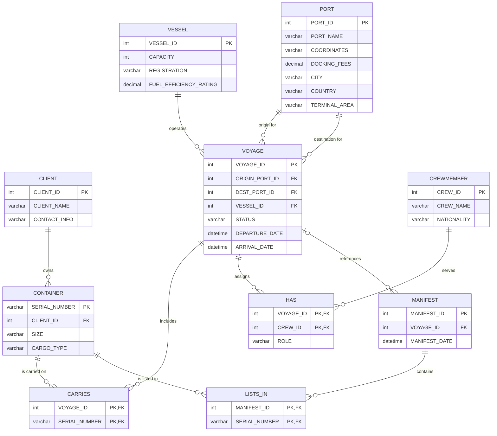

# Maritime Shipping Management System

A C# desktop application for managing the main records behind a maritime shipping operation. It connects a Windows Forms interface to a SQL Server database and supports record management, joined views, and reporting queries across voyages, vessels, ports, containers, clients, crew, and manifests.

**Tech stack:** C# · Windows Forms · .NET Framework 4.7.2 · Microsoft SQL Server · ADO.NET

## Features

- **Manage records:** View, insert, update, and delete records for clients, ports, vessels, voyages, containers, crew members, manifests, and the relationship tables.
- **Browse database tables:** Select a table and view its data in the application.
- **Run join queries:** View complete voyage details, containers with their clients and voyages, crew assigned to a voyage, containers in a manifest, and container counts per voyage.
- **Run business inquiries:** Find the most transported cargo type, vessels without voyages in the previous month, the captain with the most voyages in that period, clients without shipments, containers associated with destination ports, and container totals by vessel.
- **Relational data model:** Uses primary keys, foreign keys, and composite keys to keep linked records organized.
- **Sample data:** The SQL script includes sample records for testing the database and queries.

## Database design

The database contains ten tables. `CARRIES`, `HAS`, and `LISTS_IN` resolve many-to-many relationships; `VOYAGE` links vessels to origin and destination ports.

### Entity relationship diagram

The diagram below follows the tables and foreign-key relationships defined in the SQL schema.



### Relationship notes

- A client can own multiple containers; each container belongs to one client.
- Each voyage uses one vessel and has an origin port and a destination port.
- A voyage can carry multiple containers, and a container can be assigned to multiple voyages through `CARRIES`.
- Crew members can work on multiple voyages. `HAS` stores the crew member's role on each voyage.
- A manifest can list multiple containers through `LISTS_IN`. Its voyage reference is nullable in the schema.

## Requirements

- Windows
- Visual Studio with **.NET desktop development** support
- .NET Framework 4.7.2
- Microsoft SQL Server (for example, SQL Server Express)
- SQL Server Management Studio (recommended for setting up and inspecting the database)

## Setup

### 1. Create the database

1. Open SQL Server Management Studio and connect to your SQL Server instance.
2. Create a database named `Maritime Shipping`.
3. Open `DDl File/DDL File.sql` and execute it against that database.

**Important:** The SQL script drops existing tables before recreating them, then creates the schema and inserts sample data. Running it against an existing database can delete the data in those tables. Use a fresh or backed-up database.

### 2. Configure the connection

Open `DatabaseManager.cs` and update `CONNECTION_STRING` to match your local SQL Server instance and database.

The current connection string is configured for a local SQL Server Express instance and Windows Authentication:

```csharp
private const string CONNECTION_STRING =
    "Server=AhmedBahaa\\SQLEXPRESS;Database=Maritime Shipping;Integrated Security=True;";
```

For example, if your SQL Server instance is named `SQLEXPRESS`, the server part may be `.\SQLEXPRESS`. Keep the database name consistent with the database you created.

### 3. Open and run the application

1. Open the C# Windows Forms project in Visual Studio.
2. Restore or resolve any required .NET Framework references.
3. Confirm that the connection string points to your SQL Server instance.
4. Build and run the application.

If the repository does not contain a Visual Studio solution or project file in your checkout, create/open a Windows Forms project targeting .NET Framework 4.7.2 and add the source files and resources from the repository.

## Repository layout

```text
Maritime-Shipping/
├── DDl File/
│   └── DDL File.sql        # Table definitions, relationships, and sample data
├── ERDs/
│   ├── MY_CERD.pdf         # Conceptual ERD
│   ├── My_PERD.pdf         # Physical ERD
│   └── Updated CERD.png    # Updated conceptual ERD image
├── DatabaseManager.cs      # SQL operations and query methods
├── Form1.cs                # Windows Forms application logic
├── Form1.Designer.cs       # Windows Forms UI layout
└── Program.cs              # Application entry point
```

## Notes

- Database operations use ADO.NET with SQL parameters for query values.
- The reporting queries use the database's sample data and the date logic defined in the SQL queries; results depend on the data currently stored.
- The connection string is machine-specific and should be changed before running the application on another computer.

## Author

**Ahmed Bahaa** · [GitHub](https://github.com/Ahmed-Bahaa06)
